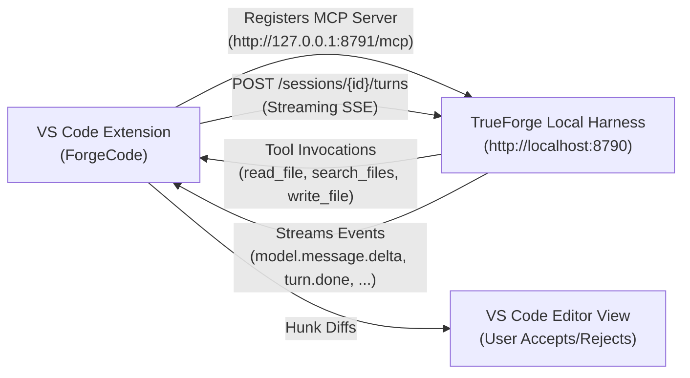

# ForgeCode — Editor-Native Coding Agent on TrueForge

> **Techfest 2026–27 | TrueFoundry Forge-a-thon Submission**  
> An editor-native Visual Studio Code coding agent powered by the **TrueForge** agent harness.  
> Integrates MCP editor capabilities, RAG keyword-retrieval context budgeting, hunk-by-hunk diff reviews with undo history, model failover resilience, and native context compaction.

---

## 📌 Upstream Fork & Attribution

* **Declared Fork Repository:** [RooVetGit/Roo-Code](https://github.com/RooVetGit/Roo-Code)
* **Declared Commit Point:** [`b867ec914`](https://github.com/RooVetGit/Roo-Code/commit/b867ec914) (*"Remove roocode.com web app (#12375)"*)
* **Attribution & Licensing:** The upstream [LICENSE](LICENSE) (Apache 2.0) and all original contributor attributions are strictly preserved.
* **Architecture Change:** Roo Code's internal LLM loop (`recursivelyMakeClineRequests`) has been completely replaced. The extension operates as an editor client to [TrueForge](https://github.com/truefoundry/trueforge), providing its editor actions via a local Model Context Protocol (MCP) server.

---

## 🚀 Key Features & Capabilities

1. **Inline Edit (`Ctrl+Alt+I` / `Cmd+Alt+I`)**:
   - Select code (or place the cursor) and type an instruction.
   - Generates a single-turn diff presented directly in the VS Code editor for hunk-by-hunk review before writing.
2. **Autonomous Agent Mode**:
   - Single natural language prompts drive TrueForge through multi-step tool loops (read, search, edit, command execution).
   - Discovers and edits multiple files unprompted without requiring explicit `@file` mentions.
3. **Context Assembly with Size Budgeting**:
   - Automatic RAG keyword-scoring retrieval across the workspace (`context.ts`).
   - Configurable character budget (`roo-cline.trueforge.contextBudgetChars`, default 60k chars, max 12 files).
   - Explicitly displays matched files and selection rationale in the chat stream before prepending `<retrieved-context>`.
4. **Hunk-by-Hunk Diff Safety & Working Undo**:
   - Zero silent writes to disk.
   - Every file modification opens a VS Code diff view offering **Accept Hunk**, **Reject Hunk**, or **Stop Review**.
   - Edits are committed via atomic `vscode.WorkspaceEdit`, allowing full `Ctrl+Z` undo functionality.
5. **Real-Time Streaming & Safe Cancellation**:
   - Streams reasoning and text deltas directly from TrueForge SSE events.
   - Cancellation immediately halts TrueForge turns via `POST /sessions/{id}/cancel` without leaving half-applied edits on disk.
6. **Automatic Model Resilience & Fallback**:
   - Seamlessly fails over across secondary model FQNs (`roo-cline.trueforge.fallbackModels`) on network or provider errors.
   - Guarantees the workspace remains pristine with zero changes on unrecoverable failures.
7. **TrueForge Context Compaction & Subagents**:
   - TrueForge native context compaction (`contextManagement.compaction: { enabled: true }`) automatically compresses conversation history during long runs.
   - Visual indicators stream to chat when compaction cycles begin and complete (`thread.context_compaction_*`).

---

## 🛠️ Architecture Overview



### File Layout (`src/core/trueforge/`)
* [`TrueForgeService.ts`](src/core/trueforge/TrueForgeService.ts): Singleton SDK client managing session lifecycles, MCP registration, and cancellation.
* [`mcpServer.ts`](src/core/trueforge/mcpServer.ts): Local HTTP server implementing MCP tools: `read_file`, `list_files`, `search_files`, `write_file`, `replace_in_file`, `execute_command`, `get_diagnostics`, and `open_file`.
* [`loop.ts`](src/core/trueforge/loop.ts): Consumes TrueForge streaming events, handles compaction/subagents, and manages model fallback failover.
* [`review.ts`](src/core/trueforge/review.ts): Computes unified diff hunks, displays interactive diff panels, and applies atomic `WorkspaceEdit`s.
* [`context.ts`](src/core/trueforge/context.ts): Performs keyword-scoring retrieval within the character budget.
* [`inlineEdit.ts`](src/core/trueforge/inlineEdit.ts): Executes single-turn inline code transformations.
* [`config.ts`](src/core/trueforge/config.ts): Reads VS Code settings under `roo-cline.trueforge.*`.

---

## 📦 Getting Started & Setup

### Prerequisites
* **Node.js**: `20.19.2` (or modern Node with pnpm)
* **pnpm**: `10.8.1`
* **TrueForge**: Running locally on `http://localhost:8790`

### 1. Start TrueForge
Because the extension's MCP server runs on `127.0.0.1`, allow loopback connections in TrueForge:

**PowerShell:**
```powershell
$env:OUTBOUND_URL_ALLOWED_HOSTS='["127.0.0.1"]'
npx @truefoundry/trueforge@latest
```

**Bash:**
```bash
OUTBOUND_URL_ALLOWED_HOSTS='["127.0.0.1"]' npx @truefoundry/trueforge@latest
```

### 2. Configure a Model Provider in TrueForge
Configure any OpenAI-compatible or catalog provider via TrueForge's API or using the extension's Command Palette:
* Press `Ctrl+Shift+P` -> **TrueForge: Configure OpenAI-Compatible Provider**.
* Sample configuration is provided in [`trueforge/model-provider.example.json`](trueforge/model-provider.example.json).

### 3. Build & Run the Extension
```bash
# Install dependencies
pnpm install

# Check types
pnpm --filter roo-cline check-types

# Launch in VS Code
# Press F5 or run 'Run Extension' from .vscode/launch.json
```

---

## ⚙️ Configuration Settings

| Setting | Default | Description |
| :--- | :--- | :--- |
| `roo-cline.trueforge.baseUrl` | `http://localhost:8790` | Base URL of the local TrueForge harness |
| `roo-cline.trueforge.model` | `openai/gpt-4.1` | Model FQN (`<provider>/<model>`) configured in TrueForge |
| `roo-cline.trueforge.inlineEditModel` | `""` | Optional dedicated model for inline edits |
| `roo-cline.trueforge.fallbackModels` | `[]` | List of fallback model FQNs tried automatically on failure |
| `roo-cline.trueforge.contextBudgetChars`| `60000` | Character budget for automatic file retrieval |
| `roo-cline.trueforge.agentName` | `""` | Optional saved TrueForge agent (see `trueforge/agent.json`) |
| `roo-cline.trueforge.mcpPort` | `8791` | Local port for the editor MCP server |
| `roo-cline.trueforge.autoApproveCommands` | `false` | Run terminal commands without confirmation dialogs |

---

## 📄 License

Licensed under the **Apache License, Version 2.0** ([LICENSE](LICENSE)).  
Preserves upstream attribution to Roo Code, Inc. and Cline contributors.
